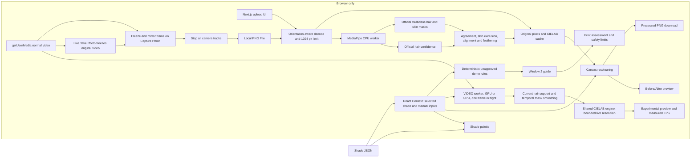

# Application architecture

One Next.js App Router app with React, strict TypeScript and Tailwind CSS. The
browser reads an uploaded or camera-captured photo, runs MediaPipe CPU models,
recolours using Canvas 2D, compares before/after and downloads a PNG. Camera
capture preview is normal video with no AI processing; a separate experimental
live mode runs VIDEO segmentation and recolouring in a worker. No image-upload API, cloud inference,
database or paid services are involved.

## Two windows and shared shade data

Window 1 provides Upload Photo, Live AI Camera (Experimental), and Take Photo tabs. Window 2 is the synchronized educational
technical guide with manual inputs, demo classifications, references, safety
locks and browser printing. Chemical formulations remain unimplemented.
`demo-shades.json` is the shared source of twelve illustrative shades, validated
with Zod. Neither its codes nor values are officially approved Al Bura colours.
No project scope PDF was present in the repository.

## Module responsibilities

- `src/app`: routes, branding, responsive theme and metadata. Server components
  emit the shell; a deep `TryOnProvider` boundary shares studio state.
  `guide.css` styles the guide, mobile tabs and print view; `camera.css` styles
  capture and live preview. `studio.css` adds final spacing, responsive controls, bounded previews,
  search/filter UI and first-time instructions.
- `components/try-on/TryOnProvider.tsx`: selected shade and manual guide inputs.
  Target level, lift difference and guide result are derived, avoiding duplicate
  state. Shade identity stays stable across guide-only updates.
- `components/try-on/TryOnStudio.tsx`: desktop panels, keyboard-accessible mobile
  tabs and shared palette. Photo/guide state stays mounted across tab switches;
  the camera unmounts when its pane is hidden on mobile.
- Other `components/try-on`: upload/replace/reset, status, error/retry, comparison
  and PNG download. The colour effect depends only on selected shade and image
  cache version and mode; guide changes do not rerun recolouring or MediaPipe.
  Hidden still photos do not recolour during live preview; leaving live reapplies
  the current shade from the cached original without another inference.
- `components/try-on/HairTryOn.tsx`: one `processPhoto(file, source)` entry for
  file picker and camera capture. It owns the original, refined mask, Lab cache,
  recolour effect, cancellation, shared comparison, downloads and object URLs.
- `components/try-on/CameraPreview.tsx`: explicit permission, normal video,
  Open/Capture/Retake/Stop, mirror preference and safe stream lifecycle. It
  receives a capture callback and never imports or initializes MediaPipe.
- `components/try-on/LiveCameraPreview.tsx`: independent raw video plus processed
  canvas with identical geometry/mirroring, measured FPS, CPU/GPU controls, errors
  and Take Photo shortcut. One awaited frame at a time, at most eight starts/sec;
  adaptive 320 → 256 → 192 bounds reduce pixel work only after sustained slow
  pixel/transfer processing; fixed-size inference time is excluded from backoff.
  Lifecycle/session guards release late streams, workers and returned bitmaps.
- `lib/ai/live-client.ts`, `live-segmentation.worker.ts`, `live-utils.ts`: fixed
  VIDEO model pair using `segmentForVideo` callbacks with increasing millisecond
  timestamps. Auto prefers hardware GPU; known software renderers, unavailable
  GPU startup, or a GPU frame failure fall back to a fresh CPU worker. Explicit
  GPU remains available for measurement. Temporal smoothing cannot expand beyond
  current hair support; scene changes, no-hair frames, time gaps and resized
  frames reset history. Colour smoothing stabilizes global statistics without
  blurring strand pixels. Worker-only buffer reuse and disabling timer yields
  avoid photo/UI scheduling overhead. The IMAGE worker stays separate.
- `lib/camera.ts`: permission/error messages, every-track cleanup and synchronous
  frame freezing/mirroring followed by PNG File encoding. Capture limits the
  longest dimension to the existing 1024 px processing limit.
- `lib/ai/mediapipe.ts`: one reusable IMAGE worker, typed responses, timeouts and
  cleanup. Factories dynamically import the official SDK in the browser/worker.
- `lib/ai/segmentation.worker.ts`: IMAGE inference with both existing verified
  models. Strong agreement anchors connected strand recovery when one model
  is uncertain but both provide hair evidence. Conservative skin exclusion
  blocks recovery across face/body boundaries. It returns owned mask arrays and closes
  incoming bitmaps in `finally`. The separate typed VIDEO protocol cannot
  reconfigure this IMAGE worker.
- `lib/ai/hair-segmentation.ts`: verified output extraction. Native result buffers
  are copied before `result.close()` for IMAGE, or inside the native callback
  lifetime for VIDEO. Transferred ImageBitmaps close in `finally`.
- `lib/ai/mask-utils.ts`: bilinear pixel-centre resizing, confidence threshold,
  connected tiny-region removal, bounded inward feathering, skin exclusion and
  development overlay. No hand-painted mask or fixed head template is used.
- `lib/ai/hair-recolor.ts`: cache active hair indices, compact Lab values,
  weighted mean and a bounded upper-tone histogram anchor once per photo.
  Shade changes visit those indices rather than converting the full image again.
  Monotonic bounded lightness, source chroma detail, a saturation cap, highlight
  protection and hue-preserving sRGB gamut fitting reduce flat/tinted reflections.
  Zero-mask pixels retain their exact original RGBA bytes. Loops yield and use
  AbortSignal to suppress stale replacements and rapid selections.
- `lib/ai/photo-utils.ts`: validation, orientation-aware decode, downscale, canvas
  conversion and object URL creation. URLs, bitmaps, caches and workers are
  released on replace/reset or route teardown as appropriate.
- `lib/color`: sRGB/D65 XYZ/CIELAB math, chroma-only gamut fitting and pure
  shade search/family filtering. `ShadePalette` stores only its local filter state;
  filtering never mutates the selected Context shade.
- `lib/guide/guide-rules.ts`: pure level/history classification, input validation,
  warnings and a fixed `demo_unapproved` status; no formulation values.
- `lib/guide/guide-reference.ts`: illustrative level/pigment values, manual input
  options, notices and locked categories sourced from the supplied brief.
- `components/guide`: controlled level/history inputs, synchronized shade summary,
  lift assessment, educational chart, review pathway, approval locks and print UI.
- `public/models`: original official binaries, checksums, licenses/model cards.
- `public/wasm`, `public/workers`: generated local runtime assets, ignored by Git.
  `scripts/sync-mediapipe-assets.ts` copies locked SDK files and bundles the
  separate TypeScript workers with esbuild on install and before dev/build.
- `tests/vision.test.ts`: meaningful pure-math, mask, cancellation and pixel
  preservation checks. `tests/guide.test.ts` covers the demo rule boundaries and
  all 300 level/history combinations. `tests/camera.test.ts` verifies camera
  errors, cleanup, unready-frame rejection and IMAGE result buffer ownership.
  `tests/shades.test.ts` verifies metadata/filtering. See `PHASE_5_REPORT.md`
  for historical browser/photo evidence; `tests/live.test.ts` and
  `LIVE_CAMERA_REPORT.md` cover the restored three-mode workflow.

## Configuration, privacy and deployment

`.env` is a real private local file in the application root. Next.js reads it;
only the non-secret `NEXT_PUBLIC_` asset paths and development debug flag are
exposed at build time. No API secret is needed. `.env` is ignored and is never
copied to `public`, deployment source or a build archive. Sensible asset-path
defaults also let a clean clone build without missing credentials.

Static export (`output: "export"`) emits `out/`, including models, WASM and the
workers. Serve it from the domain root over HTTPS/localhost. Photo uploads and
processing remain in browser memory; only model/website assets are downloaded.
`npm start` is a loopback-only export preview, not a production backend.
`vercel.json` serves the same `out` export with the Other framework preset; see
the README for root-directory, Node 22.x, build commands and Hobby eligibility.
No Vercel credentials/project linkage or deployed URL are configured here.

A production project can later introduce Next.js API routes, Prisma/PostgreSQL,
an admin panel, a complete 180-shade database, brand-approved guide rules, and an
optional FastAPI rendering service. None is implemented. Adding server routes
requires changing the static export deployment and deliberately defining privacy.

Sources: [Next.js static export](https://nextjs.org/docs/app/guides/static-exports),
[Google ImageSegmenter](https://developers.google.com/edge/mediapipe/solutions/vision/image_segmenter),
[model provenance](../public/models/README.md).
