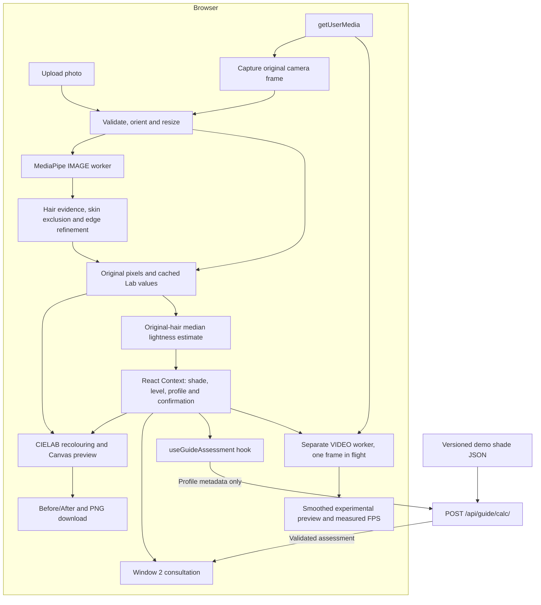

# Al Bura Colour Studio architecture

One full-stack Next.js App Router application serves the homepage, try-on studio,
three API handlers and static model assets. It deploys to Vercel with the Next.js
preset and `.next` output. Node 22 is used for development/build and API routes.
The original static-export implementation has been replaced; historical phase
reports describe that earlier state.

For an interview explanation and source reading order, start with
[INTERVIEW_GUIDE.md](INTERVIEW_GUIDE.md). This document describes the technical flow.

## Source organization

`src/web` owns the screens, React UI, styles, browser camera and AI workers.
`src/api` owns HTTP handlers, request schemas and backend services. `src/shared`
holds catalogue data, types and pure rules used by both. Next.js entry files in
`src/app` delegate to those modules; public routes and Vercel settings stay the
same. See [PROJECT_STRUCTURE.md](PROJECT_STRUCTURE.md) for the folder map and
NestJS/Python tradeoffs.

## Browser: vision and interaction

- `HairTryOn.tsx` provides one `processPhoto(file, source)` entry point for upload
  and capture. IMAGE segmentation is performed once per photo. Changing shades
  reuses the refined mask, original pixels and Lab cache.
- `CameraPreview.tsx` shows ordinary camera video. Capturing freezes and mirrors
  the original video frame, stops tracks and creates a local PNG File.
- `LiveCameraPreview.tsx` uses `segmentForVideo` through a separate worker. It
  supports GPU/CPU segmentation, automatic CPU fallback, adaptive frame sizes,
  temporal smoothing and measured FPS. One frame is in flight at a time.
- Both existing official models are self-hosted: a hair-only segmenter and a
  multiclass selfie model supplying additional hair evidence and skin protection.
- `mask-utils.ts` aligns confidence masks, protects skin, removes small islands
  and feathers boundaries. IMAGE mode includes bounded recovery of supported
  strands and small gaps. It does not paint a fixed head-shaped mask.
- `hair-recolor.ts` uses CIELAB, bounded lightness changes, source colour detail,
  highlight protection and gamut mapping. Recolouring currently uses pixel
  calculations and Canvas; GPU segmentation is not a WebGL recolouring shader.
- `photo-analysis.ts` estimates starting depth from the original hair pixels using
  an illustrative scale. Lighting and existing colour affect this approximation;
  the user confirms or overrides it before consultation export.
- `TryOnProvider.tsx` shares the shade, hair profile, photo estimate and confirmation.
  `useGuideAssessment.ts` owns consultation HTTP requests, a 120 ms debounce,
  cancellation and the labelled local fallback. Guide changes do not rerun segmentation.
  `GuideRequest` in shared types describes the metadata-only request; the backend's
  Zod schema checks actual incoming values.

## Server and data

| Route | Responsibility |
| --- | --- |
| `GET /api/shades/` | Twelve illustrative shades and their data version |
| `POST /api/guide/calc/` | Strict Zod validation, trusted shade lookup, deterministic level/history assessment and contextual notes |
| `GET /api/health/` | Service health, data version and browser-only processing status |

The assessment endpoint accepts bounded JSON profile metadata. It rejects
unknown fields and invalid levels/options. It does not accept images or output
chemical formulas. Responses are not cached. The demo catalogue is validated
from `src/shared/data/demo-shades.json`; no database or administration service is claimed.

The request path is `app/api/guide/calc/route.ts` → `api/handlers/guide.ts` →
`api/services/guide-service.ts`. The handler handles HTTP/JSON, the schema validates
the profile, and the service resolves its own shade before invoking shared rules.
The studio's initial catalogue is passed directly from its server page to React;
it does not make an HTTP request to its own catalogue endpoint.

These source folders form one modular application, not separately deployed
microservices. `web/` contains server-rendered page composition as well as client
components; camera, pixel access and inference execute only in the browser.
The shared rule functions are used by the service and browser fallback. Consultation
is deterministic; MediaPipe is the AI segmentation stage. See the
[structure decisions](PROJECT_STRUCTURE.md#why-keep-the-current-stack) for future
NestJS/Python options.

## Presentation

React, TypeScript, Tailwind and custom CSS provide the responsive UI. Instrument
Serif and Manrope are self-hosted through `next/font/local`, with their licenses
included. `globals.css` defines the editorial theme and homepage; `studio.css`
styles working controls; `camera.css`, `guide.css` and `consultation.css` style
camera and consultation components. Mobile tabs preserve photo/profile state and
stop hidden camera resources. Homepage shade links preselect the shared shade.

The original generated homepage portrait is an explicitly labelled editorial
asset. It is not a demonstrated AI recolouring result. See `DESIGN_UPDATE.md` for
asset provenance, the generation prompt and design verification.

## Privacy and lifecycle

Images, video frames, masks and inference remain in browser memory. Only the
selected shade and profile fields reach the guide API. Object URLs, image
bitmaps, workers, camera tracks and stale jobs are released on replacement,
reset, mode changes or teardown as appropriate. No paid AI API is used.

The local `.env` is ignored. Only non-secret public asset paths/debug settings
use `NEXT_PUBLIC_`. Build hooks bundle workers and copy matching SDK/WASM assets;
checksums verify both original model binaries.

## Verification and production roadmap

`npm run deploy:check` runs route type generation, TypeScript, zero-warning
ESLint, 52 tests, the production build and asset verification. Native Chrome
workflow checks use real portraits and a virtual webcam. They cover all three
modes, cache reuse, comparison/download, resource cleanup, responsive layouts,
photo-to-consultation handoff and actual PDF output.

On **24 November 2026**, the readability/hook refactor passed that full command
and **16 focused production-browser checks**: real IMAGE processing, cached shade
changes, shared state, confirmation, metadata-only requests, stale-request cancellation,
API failure/recovery, comparison, actual PNG download, mobile state and camera release.
The focused test used the app's labelled editorial image as a functional fixture
and a virtual camera; it does not measure segmentation accuracy or certify hardware.
The earlier broader mode/PDF check record is preserved in the dated submission reports.

Remaining production work includes official measured shade data, database/admin
publishing, approved formulation rules/limits, calibrated colour evaluation,
physical-device and cross-browser QA, monitoring and operational controls. See
`INTERVIEW_SUBMISSION.md` for the supplied PDF scope mapping.
