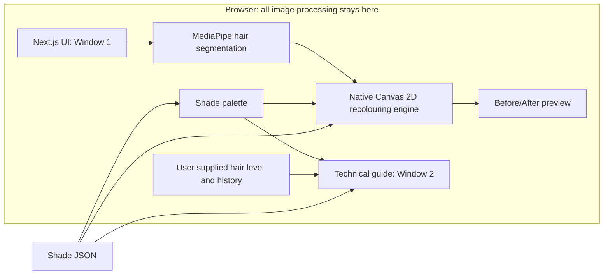

# Phase 1 architecture

One Next.js App Router application, React, strict TypeScript, Tailwind CSS, and
native browser APIs. No backend, database, paid AI API, image-upload endpoint, or
separate inference service is needed for this demo.

## Two-window experience

- **Window 1 — virtual try-on:** portrait upload, future browser segmentation,
  Canvas recolouring, and before/after preview.
- **Window 2 — technical guide:** current hair level, target shade, and future
  brand-approved colour guidance.
- **Shared palette:** a single validated shade JSON source will feed both windows.

The repository had no project scope PDF on 2026-11-22. This scaffold follows the
two-window requirements in the supplied request. Shade values, codes, and names
are provisional illustrative content, **not** scope-derived or brand-approved.
No brand formula, mixing ratio, developer strength, lift rule, or application time
has been invented.

## Intended browser pipeline — Phase 2



The arrows describe future integration, not implemented Phase 1 behaviour. All
current components are static shells. No photo is read, camera accessed, model
initialized, inference performed, pixel changed, or technical rule calculated by
the application UI. The server/build renders the shell and validates JSON only.

## Boundaries

```text
albura-ai-demo/
  src/
    app/
      page.tsx, layout.tsx, globals.css, icon.svg
      try-on/page.tsx
    components/
      layout/Header.tsx, Footer.tsx
      try-on/PhotoUploader.tsx, HairTryOn.tsx, BeforeAfterSlider.tsx,
             ShadePalette.tsx, CameraPreview.tsx
      guide/TechnicalGuide.tsx, HairLevelSelector.tsx, SafetyWarnings.tsx
      ui/Button.tsx, Card.tsx
    lib/
      ai/mediapipe.ts, hair-segmentation.ts, hair-recolor.ts, mask-utils.ts
      color/color-utils.ts
      guide/guide-rules.ts
      utils.ts
    data/demo-shades.json, shades.ts
    types/shade.ts, try-on.ts, guide.ts
  public/
    models/hair_segmenter.tflite, hair-model-card.pdf, LICENSE-2.0.txt, README.md
    wasm/                         generated runtime, ignored by Git
    images/                       reserved for approved assets
  scripts/                        TypeScript setup and verification utilities
  docs/ARCHITECTURE.md, IMPLEMENTATION_PLAN.md, SETUP.md, VERIFICATION.md
  .openai/hosting.json             static Sites hosting identity
  .nvmrc, .env.example, package.json, package-lock.json
  next.config.ts, tsconfig.json, eslint.config.mjs
```

| Location | Responsibility / Phase 2 extension point |
| --- | --- |
| `src/app` | `/` overview, `/try-on/` studio, shared layout, theme |
| `components/layout`, `components/ui` | Accessible navigation and reusable primitives |
| `components/try-on` | Upload, camera, preview, comparison, and palette shells |
| `components/guide` | Guide, current-level selector, and warning shells |
| `lib/ai/mediapipe.ts` | Explicit browser-only factory; CPU WASM, IMAGE mode, no inference |
| `lib/ai/hair-segmentation.ts` | Typed inference contract only |
| `lib/ai/hair-recolor.ts`, `mask-utils.ts` | Canvas/mask contracts and verified category constants |
| `lib/color` | Colour-space contracts only |
| `lib/guide` | Guide contract and approval status; no business rules |
| `data/demo-shades.json`, `data/shades.ts` | Twelve illustrative shades, Zod validation and unique IDs/codes |
| `types` | Shade, segmentation, try-on state, and guide contracts |
| `public/models` | Pinned official model, model card, license, and provenance |
| `public/wasm` | Ignored generated copies of the installed SDK runtime |
| `scripts` | Runtime asset sync, verified model download/check, local static preview |

`createHairSegmenter()` rejects server-side calls before dynamically importing the
SDK. Its type-only SDK import is erased from server JavaScript. The returned
instance must be owned by a future client component or hook and closed on cleanup.
There is no auto-loading effect or top-level model initialization. CPU is the
default; a GPU option and fallback can be added after profiling in Phase 2.

The checked-in model and locally served WASM avoid runtime third-party CDN
requests. SDK and runtime files come from the same lockfile version. Downloading
the app/model assets is distinct from uploading a user's image: images will stay
in browser memory. Phase 2 must copy MediaPipe mask data before closing results,
release object URLs, enforce image size limits, handle model errors, and stop
camera tracks on cleanup. Segmentation quality is not a chemical colour outcome.

## Deployment and future production

`output: "export"` emits `out/`, which any static host can serve. No server or
environment secrets are required. `npm start` uses a small loopback-only local
static preview; it is not a production service.

A future production version may add Next.js API routes, Prisma + PostgreSQL, an
admin panel, the complete 180-shade database, brand-approved technical guide rules,
and an optional FastAPI service for higher-quality rendering. None is installed
or implemented now. Adding server routes requires replacing static export with
a suitable Next.js server deployment and explicitly deciding image privacy rules.

Sources: [Next.js static export](https://nextjs.org/docs/app/guides/static-exports),
[Google ImageSegmenter](https://developers.google.com/edge/mediapipe/solutions/vision/image_segmenter),
[Google hair model card](https://storage.googleapis.com/mediapipe-assets/Model%20Card%20-%20Hair%20Segmentation.pdf).
